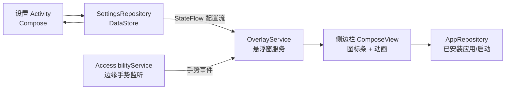

## 产品概述

一款 Android 全局悬浮侧边栏应用。在任意界面从屏幕边缘侧滑即可唤出一条可自定义的快捷应用图标栏，所有外观与手势参数均可调节，并支持配置备份与恢复。整体轻量、美观、流畅。

## 核心功能

- **全局唤出**：通过无障碍服务监听屏幕边缘手势，任意应用界面均可侧滑唤出侧边栏（悬浮窗权限 + 无障碍权限引导）
- **位置调整**：侧边栏停靠屏幕左侧或右侧，触发区跟随切换
- **外观自定义**：侧边栏条的宽度、高度、透明度均可调节
- **划出动画**：滑入/滑出动画，动画速度可调
- **图标管理**：从已安装应用中添加/删除图标，锁定常用图标防止误删误动，支持拖拽排序，提供出厂默认图标集（一键恢复）
- **手势灵敏度**：边缘滑动触发灵敏度（滑动距离阈值）与触发区高度（侧边手势热区占屏幕高度比例）可调
- **通知栏与自启动**：通知栏常驻图标开关（含暂停/恢复快捷入口）；自启动开关（RECEIVE_BOOT_COMPLETED + 跳转厂商自启动管理页引导）
- **总开关**：一键启停全部侧边栏功能
- **配置导入导出**：全部设置与图标布局导出为 JSON 文件，可从文件恢复，便于备份迁移

## 技术栈

- **语言/UI**：Kotlin + Jetpack Compose（Material 3），声明式 UI，动画 API 成熟，代码轻量
- **构建**：Gradle（Kotlin DSL）+ Gradle Wrapper，AGP 8.x，minSdk 26 / targetSdk 34，JDK 17
- **持久化**：Jetpack DataStore（Preferences）存设置；图标布局存 DataStore 序列化 JSON
- **异步**：Kotlin Coroutines + StateFlow
- **依赖注入**：不引入框架，用轻量 ServiceLocator/AppContainer 模式（KISS，项目规模小）

## 架构设计

分层架构：UI 层（Compose 设置界面 + 悬浮侧边栏 UI）→ 服务层（悬浮窗服务、无障碍服务）→ 数据层（DataStore 设置仓库、应用列表仓库）。



### 关键技术决策

1. **边缘手势检测**：无障碍服务 `onMotionEvent` 监听屏幕边缘触摸（需在 Service 配置 `flagRequestTouchExplorationMode` 相关能力与手势监听），识别边缘横向滑动后通过单例通信桥通知悬浮窗服务；同时保留细条悬浮窗兜底方案。灵敏度 = 触发所需滑动距离/速度阈值；高度 = 手势热区占屏幕高度比例。
2. **悬浮窗渲染**：`TYPE_APPLICATION_OVERLAY` + `FLAG_NOT_FOCUSABLE`，窗口内容用 `ComposeView`（服务中 `lifecycleOwner` 手动装配），布局参数由设置实时驱动（`WindowManager.updateViewLayout`）。
3. **动画**：Compose `Animatable`/`animateFloatAsState` 实现位移 + 透明度划出动画，时长由设置驱动，配合 `spring`/`tween` 平滑插值。
4. **实时生效**：设置变更通过 `StateFlow` 广播给悬浮窗服务，无需重启服务；总开关关闭时移除悬浮窗并停用手势监听。
5. **导入导出**：JSON（kotlinx.serialization）+ SAF（`ACTION_CREATE_DOCUMENT` / `ACTION_OPEN_DOCUMENT`），无存储权限需求。
6. **性能**：应用图标列表启动时异步加载并缓存（`PackageManager` 查询 + 图标 Drawable 转_bitmap 缓存），避免阻塞手势线程；悬浮窗仅在唤出时组合侧边栏内容。

## 目录结构

```
d:/dev/mySidebar/
├── build.gradle.kts            # [NEW] 根构建配置
├── settings.gradle.kts         # [NEW] 仓库与模块声明
├── gradle/libs.versions.toml   # [NEW] 版本目录（Compose BOM、DataStore、serialization）
├── gradle/wrapper/             # [NEW] Gradle Wrapper
└── app/
    ├── build.gradle.kts        # [NEW] 应用模块：compose、serialization、datastore 依赖与签名配置
    ├── proguard-rules.pro      # [NEW] 混淆规则（保留 serialization/Compose）
    └── src/main/
        ├── AndroidManifest.xml # [NEW] 权限：SYSTEM_ALERT_WINDOW、RECEIVE_BOOT_COMPLETED、FOREGROUND_SERVICE；注册两服务与 Activity
        ├── res/
        │   ├── values/strings.xml, themes.xml, arrays.xml   # [NEW] 文案、主题、标签
        │   ├── drawable/       # [NEW] 通知图标等
        │   └── xml/accessibility_service_config.xml         # [NEW] 无障碍服务配置
        └── java/com/mysidebar/
            ├── SidebarApp.kt                 # [NEW] Application：ServiceLocator 初始化
            ├── MainActivity.kt               # [NEW] 设置主界面入口 + 权限引导 + SAF 导入导出回调
            ├── data/
            │   ├── SettingsRepository.kt     # [NEW] DataStore 设置仓库（位置/宽/高/透明度/动画速度/灵敏度/热区高度/通知开关/自启动/总开关/图标布局）
            │   ├── AppRepository.kt          # [NEW] 已安装应用查询、图标缓存、启动应用
            │   └── ConfigExporter.kt         # [NEW] 配置 JSON 序列化/反序列化 + 默认配置
            ├── service/
            │   ├── OverlayService.kt         # [NEW] 前台悬浮窗服务：窗口管理、ComposeView 渲染、动画、响应手势与总开关
            │   ├── EdgeAccessibilityService.kt # [NEW] 边缘手势监听：灵敏度/热区判断，通知 OverlayService
            │   ├── BootReceiver.kt           # [NEW] 开机自启广播接收器
            │   └── ServiceBridge.kt          # [NEW] 服务间通信桥（手势事件、开关指令）
            ├── ui/
            │   ├── sidebar/SidebarPanel.kt   # [NEW] 侧边栏图标条 Compose 组件（布局、图标网格、锁定/编辑模式、动画）
            │   ├── sidebar/SidebarWindow.kt  # [NEW] 悬浮窗 ComposeView 装配与布局参数计算
            │   ├── settings/                 # [NEW] 设置界面组件
            │   │   ├── SettingsScreen.kt     # 总开关、权限引导卡片、各分区入口
            │   │   ├── AppearanceSection.kt  # 位置/宽度/高度/透明度/动画速度（滑杆 + 预览）
            │   │   ├── GestureSection.kt     # 灵敏度/触发区高度 + 手势测试区
            │   │   ├── IconsSection.kt       # 图标管理（添加选择器、删除、锁定、拖拽排序、恢复默认）
            │   │   └── GeneralSection.kt     # 通知栏图标、自启动引导、导入导出
            │   ├── components/AppPickerDialog.kt # [NEW] 应用选择对话框（搜索、图标网格）
            │   └── components/CommonControls.kt  # [NEW] 滑杆/开关/分区卡片等复用控件
            └── util/Permissions.kt           # [NEW] 悬浮窗/无障碍权限检查与跳转
```

## 设计风格

深色玻璃拟态（Glassmorphism）风格：侧边栏悬浮于任意应用之上，采用半透明磨砂质感面板 + 圆角胶囊造型，图标彩色悬浮，与深浅背景均和谐；设置界面为现代深色主题，强调滑杆实时预览的"所见即所得"体验。

## 页面规划（4 屏）

1. **设置主页**：顶部应用标题与总开关大按钮（带动效状态指示）；权限引导卡片（悬浮窗/无障碍状态灯 + 一键授权）；功能分区卡片列表（外观、手势、图标、通用）。
2. **外观设置页**：屏幕方位选择（左/右分段控件）；宽度、高度、透明度、动画速度四条滑杆，顶部提供实时缩略预览条（随滑杆即时变化）；动画速度配播放演示按钮。
3. **图标管理页**：顶部"添加应用/恢复默认/导入导出"操作栏；图标网格支持长按进入编辑模式——拖拽排序、删除按钮、锁定图钉标记；空状态引导插画。
4. **手势设置页**：灵敏度滑杆（低-中-高三档提示文案）、触发区高度滑杆（含屏幕示意图高亮热区）；底部手势练习区提示文案。

## 交互与动效

- 侧边栏划出：位移 + 渐显组合动画，速度随设置变化，收回带轻微回弹（spring）
- 悬浮窗图标：按下缩放反馈、涟漪效果、锁图标微光标识
- 设置滑杆拖动时预览条实时跟随；开关切换带弹性动画
- 总开关关闭时侧边栏淡出收回动画

## 响应式

适配手机/平板竖横屏；设置页单列卡片流，平板端最大宽度约束居中；侧边栏高度自适应屏幕百分比。