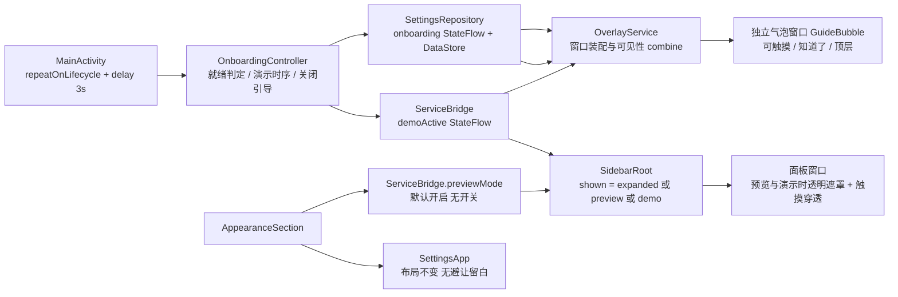

## 产品概述

对已上线的 Android 全局悬浮侧边栏应用「轻边栏」做一次体验迭代：首次使用时自动演示一次侧边栏划出，并在最上层浮层给出引导气泡；外观设置页的实时预览默认直接作用于真实侧边栏，且预览侧边栏作为独立顶层浮层，不改变设置页布局。

## 核心功能

- **首次启动自动演示**：完成悬浮窗授权后的首次启动，延时 3 秒自动播放一次「划出 → 停留约 1.5~2 秒 → 自动收回」的演示动画，仅播放一次；权限或总开关未就绪时不播放、不标记为已完成，下次回到前台 3 秒后重试。
- **顶层引导气泡**：演示开始时，在真实侧边栏旁的最上层浮层出现玻璃拟态引导气泡，带指向当前屏幕边缘热区的箭头与「从屏幕左/右侧边缘滑动即可唤出」文案，并有「知道了」按钮；演示结束后气泡仍保留，直到用户点击「知道了」才永久隐藏，关闭状态持久化，之后不再出现。
- **默认真实侧边栏预览**：外观与动画页默认即用真实悬浮侧边栏做实时预览，删除「在真实侧边栏上预览」开关及任何关闭入口；宽度、高度、透明度、停靠位置、划出动画速度依旧即拖即变，保留「重播划出动画」「刷新服务」按钮与服务未就绪时的提示。
- **预览浮层独立**：预览侧边栏始终作为独立顶层悬浮窗盖在设置页之上，删除为预览给设置页内容增加的左右避让留白，设置页布局与宽度完全不变；遮罩保持透明、窗口触摸穿透，设置页滑杆仍可正常拖动。
- **不回归既有交互**：长按图标进入编辑、原地拖拽排序、右上角 X 角标删除、锁定项不可删不可拖、配置导入导出、通知与自启动开关等既有能力保持可用。

## 视觉与交互效果

深色玻璃拟态风格延续：引导气泡为半透明磨砂圆角卡片，紫色/青色渐变描边与指向箭头，轻微呼吸动效；演示划出与收回沿用现有位移加渐显动画且速度跟随当前设置；顶部「预览中」状态标识保留（它不是开关）。

## 技术栈选择

沿用现有项目，不引入新依赖：Kotlin 1.9.24 + Jetpack Compose（Material 3，Compose BOM 2024.06.00）、Coroutines / StateFlow、Jetpack DataStore Preferences、Gradle Kotlin DSL（AGP 8.5.2、JDK 17）、minSdk 26 / targetSdk 34。悬浮层继续使用 `WindowManager` + `TYPE_APPLICATION_OVERLAY` + `ComposeView`，并复用现有 `OverlayLifecycleOwner` 与 `ViewTreeOwners.java` 的 Java 桥接装配生命周期宿主。

## 实现思路

- **内部状态与用户配置分离**：`SidebarSettings` 与 `ConfigExporter` 保持不动，避免把「是否已演示 / 引导是否关闭」写进导出的配置 JSON（否则导入他人配置会重置引导）。在同一 DataStore 中新增两个独立 boolean key，由 `SettingsRepository` 暴露 `onboarding: StateFlow&lt;OnboardingFlags&gt;`；初始化时把配置 JSON 与两个标志合并为一次 `data.first()` 读取，避免额外阻塞。
- **演示编排单点化**：新增 `OnboardingController` 作为唯一入口。`MainActivity` 在 `repeatOnLifecycle(RESUMED)` 中判断 `demoPlayed`，`delay(3000)` 后等待 `ServiceBridge.overlayRunning` 与 `Permissions.canDrawOverlays()` 就绪（带超时）；条件满足才 `markDemoPlayed()` 并把 `ServiceBridge.demoActive` 置 true，延时 `animationDurationMs + 1800ms` 后置 false，面板自动收回。切后台会取消延时且不会标记，回前台重新计时重试。
- **状态互不干扰**：演示态使用独立 `demoActive`，不借用 `previewMode` 的 start/stop；`SidebarRoot` 的可见条件改为 `expanded || preview || demo`，因此演示结束时的 `stopPreview()` 不会误关外观页常驻预览；演示期间遮罩同样透明、窗口保持触摸穿透，用户手势唤出、暂停或总开关关闭时取消演示。
- **气泡必须独立成窗**：预览态与收起态的面板窗口是 `FLAG_NOT_TOUCHABLE`，气泡上的「知道了」若放在面板内将无法点击。因此新增第三个仅气泡尺寸的可触摸 `TYPE_APPLICATION_OVERLAY` 小窗口（`WRAP_CONTENT` + `FLAG_NOT_FOCUSABLE` + `FLAG_NOT_TOUCH_MODAL`），气泡之外触摸全部透传；按「细条热区 → 面板 → 气泡」顺序 addView，保证气泡处于最上层。
- **气泡可见性可恢复**：可见条件为 `!guideDismissed && (demoPlayed || demoActive)`，由 `combine` + `distinctUntilChanged` 驱动，服务重启后仍能恢复显示，直到 `dismissGuide()` 写盘并移除窗口。
- **第 2、3 条**：外观页删除 `previewEnabled` 状态、`SwitchRow`、`LaunchedEffect` 与 `rememberUpdatedState`，`DisposableEffect` 改为 ON_RESUME 无条件 `startPreview()`、ON_PAUSE 与 dispose `stopPreview()`；`SettingsApp` 删除 `targetPad` / `animateDpAsState` / 左右 padding 及 `Side`、`animateDpAsState` 导入，仅保留 `previewActive` 驱动的「预览中」状态标识。

## 架构设计



## 目录结构

```
d:/dev/mySidebar/app/src/main/java/com/mysidebar/
├── data/
│   └── SettingsRepository.kt                 # [MODIFY] 新增 OnboardingFlags 数据类（同文件内）、demoPlayed/guideDismissed 两个 booleanPreferencesKey、onboarding StateFlow；合并为一次 DataStore 读取；提供 markDemoPlayed() / dismissGuide()，内存先更新再异步落盘；config_json 逻辑不变
├── service/
│   ├── ServiceBridge.kt                      # [MODIFY] 新增 demoActive: MutableStateFlow(false)；保留 previewMode / replayToken / open / close / toggle / sync 不动
│   ├── OnboardingController.kt               # [NEW] 演示编排：play() 置 demoActive=true、写 demoPlayed、按 animationDurationMs+1800ms 延时后复位；dismissGuide() 写持久化并隐藏气泡；cancel() 取消 Job 并复位 demoActive；使用独立 Main.immediate 作用域
│   └── OverlayService.kt                     # [MODIFY] combine(demoActive, onboarding) 控制气泡窗口 addView/removeViewImmediate；新增 guideView / guideLifecycleOwner 字段与 setGuideBubble(show)；refreshPanelTouchFlags 追加 !demoActive 条件；Open/Close/Toggle、paused、masterEnabled=false、onDestroy、onConfigurationChanged 处取消演示或更新气泡布局参数；气泡随 side 变化 updateViewLayout
├── ui/
│   ├── sidebar/
│   │   ├── SidebarPanel.kt                   # [MODIFY] 仅改 SidebarRoot：收集 demoActive，shown 改为 expanded || preview || demo，遮罩 alpha 在 preview 或 demo 时为 0 且不可点击；长按拖拽排序与 X 角标删除逻辑保持不动
│   │   ├── SidebarWindow.kt                  # [MODIFY] 新增 createGuideView(owner, onDismiss)（复用 ViewTreeOwners.attach + MySidebarTheme + GuideBubble）与 guideParams(settings)（WRAP_CONTENT、按 side 取 START/END + CENTER_VERTICAL、x 为 panelWidthDp 加边距、FLAG_NOT_TOUCH_MODAL）
│   │   └── GuideBubble.kt                    # [NEW] 顶层引导气泡 Compose 组件：方向箭头指向边缘热区、中文提示文案、「知道了」按钮回调 onDismiss、渐变描边与轻微呼吸动效
│   └── settings/
│       ├── AppearanceSection.kt              # [MODIFY] 删除预览开关及其状态与相关导入，默认无条件预览；保留重播/刷新按钮与两态提示；按钮 enabled 改由 canPreview 决定
│       └── SettingsApp.kt                    # [MODIFY] 删除 previewPad 及左右 padding、animateDpAsState/Side 导入；保留 previewActive 用于「预览中」状态标识
└── MainActivity.kt                           # [MODIFY] onCreate 中 lifecycleScope + repeatOnLifecycle(RESUMED) 实现 3 秒延时、权限与服务就绪等待、跳过 EXTRA_OPEN_PICKER 启动、调用 OnboardingController.play()
```

说明：`SidebarSettings.kt`、`ConfigExporter.kt`、`SidebarSettings.sanitized()`、`ViewTreeOwners.java`、`OverlayLifecycleOwner.kt`、`Permissions.kt`、`EdgeGestureDetector.kt`、`AndroidManifest.xml` 与 Gradle 配置均无需改动，配置导入导出格式与版本保持兼容。

## 关键代码结构

```
// SettingsRepository.kt 内新增，仅进程内状态，不进入 ConfigExporter
data class OnboardingFlags(val demoPlayed: Boolean = false, val guideDismissed: Boolean = false)

// OnboardingController.kt 对外契约（无实现体）
object OnboardingController {
    fun play(context: Context)
    fun dismissGuide()
    fun cancel()
}
```

## 实现注意事项

- **触摸穿透是硬约束**：面板窗口在 preview / demo / 收起态必须保持 `FLAG_NOT_TOUCHABLE`；气泡窗口只用 `FLAG_NOT_TOUCH_MODAL` 且尺寸仅包裹气泡，避免拦截设置页或其它应用的触摸。
- **边界与幂等**：`play()` 需可重入保护（已有 Job 未结束则忽略）；服务销毁、总开关关闭、暂停唤出、用户真实手势唤出时调用 `cancel()`，避免演示中途把侧边栏强行收回。`markDemoPlayed()` 只在确认权限就绪且演示真正开始后写入。
- **视觉规范**：气泡沿用主色 `#6C5CE7`、`#8B7CF8`、`#00D9C0`，背景 `#1E1E28` 半透明，圆角 18~22dp，1dp 渐变描边；箭头随 `Side.LEFT/RIGHT` 翻转并指向边缘细条热区中心；「知道了」按钮点击后立即移除窗口并持久化，附淡出动画。
- **性能**：气泡窗口仅在可见时创建；`onboarding` 与 `demoActive` 的合并流使用 `distinctUntilChanged`；动画进度继续在 `graphicsLayer` / `offset` 的 lambda 内读取，避免逐帧重组；不在设置页新增任何布局测量或避让计算。
- **取舍说明**：保留现有 ON_PAUSE 自动收回预览的行为，避免侧边栏常驻其它应用上方；气泡按用户选择「常驻直到关闭」实现为顶层小窗口，仅在总开关关闭或服务销毁时随窗口移除，条件再次满足且未关闭时恢复。
- **验证**：`.\gradlew.bat :app:assembleDebug :app:lintDebug --no-daemon --console=plain` 需 0 Error；随后用 `adb -s adb-3437965471002IE-BXu62M._adb-tls-connect._tcp install -r -d d:\dev\mySidebar\app\build\outputs\apk\debug\app-debug.apk` 覆盖安装到 vivo V2136A，验证首次 3 秒演示、气泡常驻与「知道了」、外观页无开关且设置页宽度不变、滑杆仍可拖动、长按拖拽排序与 X 角标删除无回归。

## Agent Extensions

### Skill

- **lsp-code-analysis**
- Purpose: 精确定位 `previewMode`、`startPreview()`、`stopPreview()`、`replayToken`、`refreshPanelTouchFlags()`、`SidebarRoot.shown` 与全部 `WindowManager.addView` 调用点，确认改造边界与窗口叠加顺序。
- Expected outcome: 产出完整引用清单；改造后复核无残留的预览开关引用、无残留避让 padding 引用，且新增 `demoActive` / `guideDismissed` 的所有读写点均已覆盖。