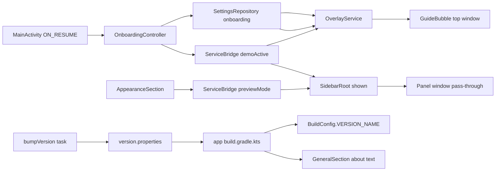

## 产品概述

对已上线并可安装的 Android 全局悬浮侧边栏应用「轻边栏」做一次体验迭代：首次使用时自动演示一次侧边栏划出，并用最上层引导气泡教会用户如何唤出；外观设置页默认直接用真实侧边栏实时预览且预览浮层不挤占设置页；同时建立可手动运行、规则明确的版本号递增机制。

## 核心功能

- **首次启动自动演示**：完成悬浮窗授权、总开关与服务就绪后的首次启动，延时 3 秒自动播放一次「划出 → 停留约 1.5~2 秒 → 自动收回」；仅播放一次。权限或总开关未就绪时不播放、也不标记已完成，下次回到前台 3 秒后重试。切到后台会取消本次演示且不标记。
- **顶层引导气泡**：演示开始时，在真实侧边栏旁的最上层浮层出现玻璃拟态气泡，带指向当前屏幕边缘热区的箭头、「从屏幕左/右侧边缘滑动即可唤出」文案与「知道了」按钮；演示结束后气泡仍保留，直到用户点击「知道了」才永久隐藏，关闭状态持久化，之后不再出现。
- **默认真实侧边栏预览**：外观与动画页进入即默认开启真实侧边栏实时预览，删除「在真实侧边栏上预览」开关及任何关闭入口；宽度、高度、透明度、停靠位置、划出动画速度依旧即拖即变，保留「重播划出动画」「刷新服务」按钮与服务未就绪提示。
- **预览浮层独立**：预览侧边栏始终作为独立顶层悬浮窗盖在设置页之上，删除为预览给设置页内容增加的左右避让留白，设置页布局与宽度完全不变；遮罩保持透明、窗口触摸穿透，滑杆仍可正常拖动。顶部「预览中」状态标识保留（它不是开关）。
- **版本管理**：本次交付版本设为 1.0.1、版本码 1001；新增手动运行的递增任务（不与构建绑定、不引入版本控制依赖）。版本号三段各为 0–9，逐级进位：1.0.8→1.0.9→1.1.0，1.9.9→2.0.0；到 9.9.9 后再递增停止并报错。版本码由三段拼成整数（1.0.1→1001、1.1.0→1100、2.0.0→2000）。关于页显示的版本号自动跟随构建，不再硬编码。
- **不回归**：长按图标进入编辑、原地拖拽排序、右上角 X 角标删除、锁定项不可删不可拖、配置导入导出、通知与自启动开关等既有能力保持可用。

## 视觉与交互效果

深色玻璃拟态风格延续：引导气泡为半透明磨砂圆角卡片，紫色/青色渐变描边、随左或右停靠方向翻转的指向箭头、轻微呼吸动效；演示划出与收回沿用位移加渐显动画且速度跟随当前设置；气泡「知道了」点击后淡出。设置页视觉与布局完全不变。

## 技术栈选择

沿用现有项目，不引入新依赖：Kotlin 1.9.24 + Jetpack Compose（Material 3，Compose BOM 2024.06.00）、Coroutines / StateFlow、Jetpack DataStore Preferences、Gradle Kotlin DSL（AGP 8.5.2、Gradle Wrapper 8.9、JDK 17）、minSdk 26 / targetSdk 34 / compileSdk 34。悬浮层继续用 `WindowManager` + `TYPE_APPLICATION_OVERLAY` + `ComposeView`，复用 `OverlayLifecycleOwner` 与 `ViewTreeOwners.java` 的 Java 桥接装配生命周期宿主。版本文件用标准 `java.util.Properties` 读写，递增任务用 Gradle Kotlin DSL 注册，不引入脚本引擎或第三方插件。

## 实现思路

1. **内部状态与用户配置分离**：`SidebarSettings`、`ConfigExporter`、`sanitized()` 保持不动，避免把「是否已演示 / 引导是否关闭」写进导出的配置 JSON（否则导入他人配置会重置引导）。在同一 DataStore 中新增两个 `booleanPreferencesKey`，由 `SettingsRepository` 暴露 `onboarding: StateFlow&lt;OnboardingFlags&gt;`；把配置 JSON 与两个标志合并为一次 `data.first()` 读取，避免额外阻塞主线程。写操作沿用「先更新内存、再异步落盘」既有模式。
2. **演示编排单点化**：新增 `OnboardingController` 作为唯一入口，持有唯一可取消 Job 与 `Main.immediate` 作用域。`MainActivity` 在 `repeatOnLifecycle(RESUMED)` 中触发：`delay(3000)` 后带超时等待 `ServiceBridge.overlayRunning`、`Permissions.canDrawOverlays()`、总开关与 `demoPlayed` 全部满足；条件满足才写 `demoPlayed`、把 `ServiceBridge.demoActive` 置 true，延时 `animationDurationMs + 1800ms` 后置 false 让面板自动收回。切后台、服务销毁、总开关关闭、暂停或用户真实手势唤出时 `cancel()` 取消演示并复位状态，不写入已播放标记。`play()` 需幂等保护。
3. **状态互不干扰**：演示态使用独立 `demoActive`，不借用 `previewMode` 的 start/stop，避免演示结束时误关外观页常驻预览；`SidebarRoot` 的可见条件改为 `expanded || preview || demo`（仍受 `replayHidden` 约束），演示期间遮罩同样透明且不可点击，面板窗口保持 `FLAG_NOT_TOUCHABLE`。
4. **气泡必须独立成窗**：预览/演示/收起态面板窗口是 `FLAG_NOT_TOUCHABLE`，气泡上的「知道了」放在面板内将无法点击。新增第三个仅气泡尺寸的可触摸 `TYPE_APPLICATION_OVERLAY` 小窗口（`WRAP_CONTENT`、`FLAG_NOT_FOCUSABLE`、`FLAG_NOT_TOUCH_MODAL`、无 `NOT_TOUCHABLE`），气泡之外触摸全部透传；按「细条热区 → 面板 → 气泡」顺序 `addView` 保证气泡最上层。可见条件为 `!guideDismissed &amp;&amp; (demoPlayed || demoActive)`，由 `combine` + `distinctUntilChanged` 驱动，服务重启后仍能恢复；`dismissGuide()` 写盘后移除窗口。
5. **版本单一真源**：新增根目录 `version.properties` 保存三段数字；`app/build.gradle.kts` 读取它计算 `versionName` 与 `versionCode = major*1000 + minor*100 + patch`。在根 `build.gradle.kts` 注册 `bumpVersion` 任务：校验三段均为 0–9 → 计算下一段 → 越界抛错 → 原子写回固定格式文件。任务与 `assembleDebug` 完全解耦，仅显式运行 `.\gradlew.bat bumpVersion` 才改变版本。关于页通过 `BuildConfig.VERSION_NAME` 显示（AGP 8.x 默认不生成 BuildConfig，需在 `buildFeatures` 显式加 `buildConfig = true`）。
6. **第 2、3 条清理**：`AppearanceSection` 删除 `previewEnabled`、`rememberUpdatedState`、`LaunchedEffect(previewEnabled)`、`SwitchRow` 及相关导入，`DisposableEffect` 改为 ON_RESUME 无条件 `startPreview()`、ON_PAUSE 与 dispose `stopPreview()`；`SettingsApp` 删除 `targetPad`、`animateDpAsState`、左右 padding 及 `Side` / `animateDpAsState` 导入，仅保留 `previewActive` 驱动的「预览中」状态标识。

## 实现注意事项

- **触摸穿透是硬约束**：面板窗口在 preview / demo / 收起态必须保持 `FLAG_NOT_TOUCHABLE`；`refreshPanelTouchFlags()` 的可触摸条件改为 `expanded &amp;&amp; !previewMode &amp;&amp; !demoActive`。气泡窗口只用 `FLAG_NOT_TOUCH_MODAL` 且尺寸仅包裹气泡，避免拦截设置页或其它应用触摸。
- **气泡生命周期与方向**：气泡仅在可见时创建，用独立 `OverlayLifecycleOwner`，移除时先淡出再 `removeViewImmediate` 并 `onDestroy()`；停靠方向或横竖屏变化时用 `updateViewLayout` 更新气泡位置，箭头随之翻转。
- **幂等与边界**：`play()` 已有活跃 Job 时直接忽略；`markDemoPlayed()` 只在确认就绪且演示真正开始后写入；`9.9.9` 递增必须 `GradleException` 报错且不写文件；`bumpVersion` 需校验文件缺失或格式非法时给出可操作错误信息。
- **性能**：DataStore 合并为一次 `first()`；气泡可见性流 `distinctUntilChanged`；动画进度继续在 `graphicsLayer` / `offset` 的 lambda 内读取避免逐帧重组；不在设置页新增任何测量或避让计算；气泡窗口仅在可见时存在，避免常驻内存与 I/O。
- **日志与兼容**：复用现有 `android.util.Log.w(TAG, ...)` 模式，仅记录窗口装配失败与落盘失败，不输出包名等用户数据；配置 JSON 格式与版本不变，保证旧配置可导入；不改动 `AndroidManifest.xml`、权限声明与 Gradle 依赖版本。
- **影响面控制**：工作区不是 Git 仓库，按用户选择不执行 `git init`、不安装钩子、不引入版本控制依赖；版本递增不挂到 `assemble`；保留 ON_PAUSE 自动收回预览的行为；不触碰上一轮完成的长按拖拽排序与 X 角标删除代码。
- **验证**：`.\gradlew.bat :app:assembleDebug :app:lintDebug --no-daemon --console=plain` 需 0 Error；用临时副本验证 `bumpVersion` 的进位序列（1.0.8→1.0.9→1.1.0、1.9.9→2.0.0、9.9.9 报错）后恢复为 1.0.1；最后覆盖安装到 `adb-3437965471002IE-BXu62M._adb-tls-connect._tcp`。

## 架构设计



## 目录结构

```
d:/dev/mySidebar/
├── version.properties                       # [NEW] 唯一版本真源：major=1 / minor=0 / patch=1，格式固定、注释说明 0-9 进位规则
├── build.gradle.kts                         # [MODIFY] 根脚本注册 bumpVersion 任务（读取/校验/进位/原子写回，9.9.9 抛 GradleException）；不挂任何构建任务
├── app/build.gradle.kts                     # [MODIFY] 读取 version.properties 计算 versionName 与 versionCode=major*1000+minor*100+patch；buildFeatures 增 buildConfig = true
└── app/src/main/java/com/mysidebar/
    ├── MainActivity.kt                      # [MODIFY] onCreate 中 lifecycleScope + repeatOnLifecycle(RESUMED) 触发 3 秒延时与就绪等待，调用 OnboardingController.play()；跳过 EXTRA_OPEN_PICKER 启动；ON_PAUSE 取消
    ├── data/SettingsRepository.kt           # [MODIFY] 新增 OnboardingFlags 数据类与两个 booleanPreferencesKey；一次 data.first() 合并读取；onboarding StateFlow；markDemoPlayed()/dismissGuide() 内存优先+异步落盘
    ├── service/ServiceBridge.kt             # [MODIFY] 新增 demoActive: MutableStateFlow(false)；保留 previewMode/replayToken/commands 不变
    ├── service/OnboardingController.kt      # [NEW] 演示编排单例：play()/dismissGuide()/cancel()；持有唯一 Job 与 Main.immediate 作用域；就绪判定、3 秒延时、duration+1800ms 收回、幂等保护
    ├── service/OverlayService.kt            # [MODIFY] combine(demoActive, onboarding) 控制气泡窗口 addView/removeViewImmediate；新增 guideView/guideLifecycleOwner 与 setGuideBubble()；refreshPanelTouchFlags 追加 !demoActive；Open/Close/Toggle、paused、masterEnabled=false、onDestroy、onConfigurationChanged 取消演示或更新气泡布局
    ├── ui/sidebar/SidebarPanel.kt           # [MODIFY] 仅改 SidebarRoot：收集 demoActive，shown 改为 (expanded || preview || demo) && !replayHidden；遮罩在 preview 或 demo 时 alpha=0 且不可点击；其余长按拖拽与 X 角标代码不动
    ├── ui/sidebar/SidebarWindow.kt          # [MODIFY] 新增 createGuideView(owner, onDismiss)（复用 ViewTreeOwners.attach + MySidebarTheme + GuideBubble）与 guideParams(settings)（WRAP_CONTENT、START/END + CENTER_VERTICAL、x 为面板宽加边距、FLAG_NOT_TOUCH_MODAL）
    ├── ui/sidebar/GuideBubble.kt            # [NEW] 顶层引导气泡 Compose 组件：方向箭头指向边缘热区、中文提示、「知道了」按钮、渐变描边与呼吸动效、退出淡出
    ├── ui/settings/AppearanceSection.kt     # [MODIFY] 删除预览开关及 previewEnabled/rememberUpdatedState/LaunchedEffect/SwitchRow 相关状态与导入；ON_RESUME 无条件 startPreview；保留重播/刷新与两态提示，按钮 enabled 由 canPreview 决定
    ├── ui/settings/SettingsApp.kt           # [MODIFY] 删除 targetPad/previewPad/animateDpAsState 与左右 padding、Side/animateDpAsState 导入；保留 previewActive 状态标识
    └── ui/settings/GeneralSection.kt        # [MODIFY] 关于页「轻边栏 · 1.0.0」改为 BuildConfig.VERSION_NAME 拼接，避免硬编码漂移
```

`SidebarSettings.kt`、`ConfigExporter.kt`、`OverlayLifecycleOwner.kt`、`ViewTreeOwners.java`、`Permissions.kt`、`EdgeGestureDetector.kt`、`AndroidManifest.xml`、资源与 Gradle 依赖版本均保持不动。

## 关键代码结构

```
// 仅进程内状态，不进入 ConfigExporter 导出 JSON
data class OnboardingFlags(
    val demoPlayed: Boolean = false,
    val guideDismissed: Boolean = false
)

// 演示编排对外契约（无实现体）
object OnboardingController {
    fun play(context: Context)
    fun dismissGuide()
    fun cancel()
}

// 版本计算（三段各 0-9，next() 越界抛错）
data class AppVersion(val major: Int, val minor: Int, val patch: Int) {
    fun versionName(): String
    fun versionCode(): Int
    fun next(): AppVersion
}
```

## Agent Extensions

### Skill

- **lsp-code-analysis**
- Purpose: 精确定位 `previewMode`、`startPreview()`、`stopPreview()`、`replayToken`、`refreshPanelTouchFlags()`、`SidebarRoot.shown`、全部 `WindowManager.addView` 调用点，以及版本号硬编码 `1.0.0` 的全部引用，确认改造边界与窗口叠加顺序。
- Expected outcome: 产出完整引用清单；改造后复核无残留预览开关引用、无残留避让 padding 引用、无硬编码版本文案，且 `demoActive` / `guideDismissed` / `demoPlayed` 的所有读写点均已覆盖。